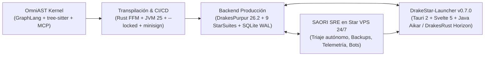

# Slimefun: New Horizons · DrakesCraft Labs

> **«La primera arquitectura soberana de alto rendimiento para Minecraft y sistemas distribuidos: 180+ plugins consolidados en suites nativas en Rust FFM sin romper el ecosistema de Java, orquestado con OmniAST y lanzado con DrakeStar.»**

[🌐 Website](https://web.drakescraft.cl) ·
[🚀 DrakeStar Launcher v0.7.0](https://github.com/SlimefunNewHorizons/DrakeStar-Launcher/releases/latest) ·
[⚡ DrakesPurpur Engine](https://github.com/SlimefunNewHorizons/DrakesPurpur) ·
[🌌 StarSuites](https://github.com/SlimefunNewHorizons/Drakes-Suites) ·
[🧬 OmniAST](https://github.com/JackStar6677-1/omniast) ·
[⚖️ Rights & Attribution](https://github.com/SlimefunNewHorizons/.github/blob/main/RIGHTS_AND_ATTRIBUTION.md) ·
[💬 Discord](https://discord.gg/rv3vtXZTk7)

---

## 🧭 Arquitectura Global del Ecosistema

---

## 🚀 Matriz de Descarga Directa — DrakeStar-Launcher (`v0.7.0` Feature-Complete)

**1-Click Play** con **Modo Dual** (**Java Aikar G1GC** + **DrakesRust / Horizon 26.3**) y **Monolito Local** (*Slimefun en solitario / LAN* arrancando `DrakesPurpur 26.2` en ~22 s en `127.0.0.1` sin configuración manual). Todas las builds son compiladas con `--locked` y firmadas criptográficamente con **minisign**.

| Plataforma | Instaladores Oficiales | Firma & Actualizador | Enlace Directo |
| :--- | :--- | :--- | :--- |
| **Windows** (x64) | `.exe` (recomendado, sin admin) · `.msi` | Minisign + Auto-Update | [Descargar Windows (latest)](https://github.com/SlimefunNewHorizons/DrakeStar-Launcher/releases/latest) |
| **Linux** (x64) | `.AppImage` · `.deb` · `.rpm` | Minisign + Auto-Update | [Descargar Linux (latest)](https://github.com/SlimefunNewHorizons/DrakeStar-Launcher/releases/latest) |
| **macOS** (Universal) | `.dmg` (Apple Silicon + Intel) | Minisign + Auto-Update | [Descargar macOS (latest)](https://github.com/SlimefunNewHorizons/DrakeStar-Launcher/releases/latest) |

---

## 🌌 Índice Canónico de StarSuites (`Drakes-Suites` Monorepo)

Consolidación soberana de **180+ micro-plugins y 94 addons históricos** en **9 suites modulares** impulsadas por **Rust SIMD Off-Heap FFM + SQLite WAL** (sacando el estado pesado fuera del Garbage Collector de la JVM):

| # | Suite | Dominio Consolidado | Estado |
| :-: | :--- | :--- | :--- |
| 1 | **`drakes-core`** | Núcleo común, puertas de modalidad (`CommandModalityGate`), puente FFM/SQLite WAL y API compartida | **Producción** |
| 2 | **`drakes-tech`** | Maquinaria industrial, automatización avanzada, redes de alto rendimiento y energía off-heap | **Producción** |
| 3 | **`drakes-magic`** | Addons arcanos, alquimia, cristales, hechizos y progresión mística | **Producción** |
| 4 | **`drakes-bio`** | Genética mendeliana (`genetic_chickens`, **`genetic_woolies`**), cultivos (`Cultivation`) y biología | **Producción** |
| 5 | **`drakes-combat`** | Jefes (`/bosses`), habilidades divinas, rangos de combate (`DrakesRankup`) y balance PvP/PvE | **Producción** |
| 6 | **`drakes-generators`** | Reactores, generadores solares/nucleares, turbinas y densidad energética | **Producción** |
| 7 | **`drakes-multiverse`** | Integración con `MultiverseNets`, `MultiverseGambling` y utilidades inter-mundo | **Producción** |
| 8 | **`drakes-utility`** | Herramientas QoL, `EnderCarryOn` blindado, mochilas, transporte y utilidades de inventario | **Producción** |
| 9 | **`drakes-server`** | Telemetría (`DrakesPerf`), moderación, economía dinámica y gobierno de TPS | **Producción** |

> **Ramas canónicas:** `main` (Paper 1.21.11 LTS) · `26.x` (Purpur 26.2 + Java 25 en Dallas Temporada 2).

---

## 📊 Clasificación de Repositorios (Zero-Assumptions)

- **🟢 Producción Activa:** `DrakeStar-Launcher` (`v0.7.0` Feature-Complete), `Drakes-Suites` (9 StarSuites), `DrakesPurpur` (motor 26.2 Java 25 + Rust FFM), `Odysseia`, `Slimefun4-Drake`, `NetworksV6-drake` (Cloud-Link + rendimiento), `MultiverseNets` (59 bloques + guía SF), `MultiverseGambling`, `drakescraft-web`, `drakescraft-texture-pack` (`t2-v28.zip`), `ai-hub` / SAORI SRE en Star VPS.
- **🔵 Soporte & Núcleo Transversal:** `OmniAST` (GraphLang + `tree-sitter-omniast` + `mcp_server`), `star-server-backup` (Zero-Secrets diario), `drakes-hq`, `maven-repo`, `slimefun-porting-tools`.
- **🧪 Sandbox / Experimental:** `drakestar-fused` (bridge mod single-JVM Fabric/NeoForge/Forge v1.0.0-alpha.2), `Slimefun-Rust` / `Odysseia-Rust`, ramas `feat/slimefun-native-engine` (motor híbrido Rust permanente).

---

## ⚙️ Directiva Operativa de Equipo (CI/CD Mandate)

1. **Cero compilaciones manuales para release:** Todo artefacto de producción se compila y firma exclusivamente mediante **GitHub Actions** (`--locked` en Rust, Maven/Gradle reproducible en Java 25 y firmas **minisign**).
2. **Despliegue seguro verificado:** Todo despliegue a Dallas pasa por verificación de SHA-256, respaldo rollback automático en Google Drive y reinicio seguro con anuncios automáticos en Discord (`#⛏️・anuncios-minecraft` y `#🚀・server-changelog`).
3. **Equipo Humano + SRE Autónoma:**
   - **JackStar (`JackStar6677-1`)** — Arquitectura Soberana & Dirección Técnica.
   - **Nix (`DrgX89`)** — Releases, CI/CD, Embalaje Multiplataforma & Linux.
   - **Chagui (`Chagui68`)** — `MultiverseNets`, `MultiverseGambling`, `DrakesPurpur` & Testing.
   - **SAORI (Star VPS 24/7)** — Triaje autónomo, monitoreo de logs, respaldos y self-healing.
