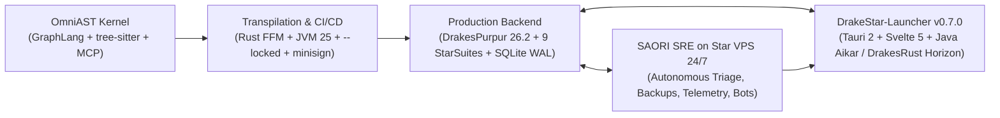

<!-- credits:start -->
> **What is DrakesCraft? / ¿Qué es DrakesCraft?**
> **EN:** DrakesCraft is a community Minecraft server (Chile) built around Slimefun. The **DrakesCraft Labs** organization keeps the open-source side: ports of Slimefun and its addons to current Minecraft/Paper (26.2, Java 25), a custom server fork (DrakesPurpur), the DrakeStar launcher and the tooling that tests all of it daily on the live server. Each addon is its own repository, built from its original author's code and published under that author's license.
> **ES:** DrakesCraft es un servidor de Minecraft comunitario (Chile) centrado en Slimefun. **DrakesCraft Labs** es la parte de código abierto: ports de Slimefun y sus addons a Minecraft/Paper actual (26.2, Java 25), un fork propio del servidor (DrakesPurpur), el launcher DrakeStar y las herramientas que lo prueban a diario en el servidor real. Cada addon es un repositorio propio, construido sobre el código de su autor original y publicado bajo la licencia de ese autor.
>
> **Credits / Créditos.** Creator and maintainer of the DrakesCraft system and ports: [JackStar6677-1](https://github.com/JackStar6677-1). Every repository credits its original authors with links at the top of its README and in `docs/UPSTREAM_ATTRIBUTION.md`; the full index is in [CREDITS.md](https://github.com/SlimefunNewHorizons/.github/blob/main/CREDITS.md). Highlights: Slimefun by [TheBusyBiscuit](https://github.com/TheBusyBiscuit) and the [Slimefun community](https://github.com/Slimefun); the Multiverse* addons by [Chagui68](https://github.com/Chagui68); launcher contributions by [DrgX89 (Nix)](https://github.com/DrgX89). Independent community project, not affiliated with or endorsed by the original authors or the official Slimefun team. Corrections: open an issue or mention [@JackStar6677-1](https://github.com/JackStar6677-1).
<!-- credits:end -->

# Slimefun: New Horizons · DrakesCraft Labs

> **"The first sovereign high-performance architecture for Minecraft and distributed systems: 180+ plugins consolidated into native Rust FFM suites without breaking the Java ecosystem, orchestrated with OmniAST and launched with DrakeStar."**

[🌐 Website](https://web.drakescraft.cl) ·
[🚀 DrakeStar Launcher v0.7.0](https://github.com/SlimefunNewHorizons/DrakeStar-Launcher/releases/latest) ·
[⚡ DrakesPurpur Engine](https://github.com/SlimefunNewHorizons/DrakesPurpur) ·
[🌌 StarSuites](https://github.com/SlimefunNewHorizons/Drakes-Suites) ·
[🧬 OmniAST](https://github.com/JackStar6677-1/omniast) ·
[📦 Maven Repo](https://maven.drakescraft.cl) ·
[⚖️ Rights & Attribution](https://github.com/SlimefunNewHorizons/.github/blob/main/RIGHTS_AND_ATTRIBUTION.md) ·
[💬 Discord](https://discord.gg/rv3vtXZTk7) ·
[🇪🇸 Español](https://github.com/SlimefunNewHorizons/.github/blob/main/profile/README_ES.md)

---

## 🧭 Global Ecosystem Architecture

---

## 🚀 Direct Download Matrix — DrakeStar-Launcher (`v0.7.0` Feature-Complete)

**1-Click Play** with **Dual Engine Mode** (**Java Aikar G1GC** + native **DrakesRust / Horizon 26.3**) and **Local Monolith Mode** (*Slimefun single-player / LAN* booting `DrakesPurpur 26.2` in ~22s on `127.0.0.1` with zero manual setup). All builds are compiled reproducibly with `--locked` and cryptographically signed with **minisign**.

| Platform | Official Installers | Signing & Updater | Direct Link |
| :--- | :--- | :--- | :--- |
| **Windows** (x64) | `.exe` (recommended, per-user) · `.msi` (per-machine) | Minisign + Auto-Update | [Download Windows (latest)](https://github.com/SlimefunNewHorizons/DrakeStar-Launcher/releases/latest) |
| **Linux** (x64) | `.AppImage` · `.deb` · `.rpm` | Minisign + Auto-Update | [Download Linux (latest)](https://github.com/SlimefunNewHorizons/DrakeStar-Launcher/releases/latest) |
| **macOS** (Universal) | `.dmg` (Apple Silicon + Intel) | Minisign + Auto-Update | [Download macOS (latest)](https://github.com/SlimefunNewHorizons/DrakeStar-Launcher/releases/latest) |

---

## 🌌 Canonical StarSuites Index (`Drakes-Suites` Monorepo)

Sovereign consolidation of **180+ micro-plugins and 94 historical Slimefun addons** into **9 modular high-performance suites** powered by **Rust SIMD Off-Heap FFM + SQLite WAL** (moving heavy state off the JVM Garbage Collector):

| # | Suite | Consolidated Domain | Status |
| :-: | :--- | :--- | :--- |
| 1 | **`drakes-core`** | Shared core, modality gates (`CommandModalityGate`), FFM/SQLite WAL bridge & common API | **Production** |
| 2 | **`drakes-tech`** | Industrial machinery, advanced automation, high-throughput networks & off-heap energy | **Production** |
| 3 | **`drakes-magic`** | Arcane addons, alchemy, crystals, spells & mystical progression | **Production** |
| 4 | **`drakes-bio`** | Mendelian genetics (`genetic_chickens`, **`genetic_woolies`**), crops (`Cultivation`) & biology | **Production** |
| 5 | **`drakes-combat`** | Bosses (`/bosses`), divine abilities, combat ranks (`DrakesRankup`) & PvP/PvE balance | **Production** |
| 6 | **`drakes-generators`** | Reactors, solar/nuclear generators, turbines & energy density | **Production** |
| 7 | **`drakes-multiverse`** | Integration with `MultiverseNets`, `MultiverseGambling` & cross-world utilities | **Production** |
| 8 | **`drakes-utility`** | QoL tools, hardened `EnderCarryOn`, backpacks, transport & inventory utilities | **Production** |
| 9 | **`drakes-server`** | Telemetry (`DrakesPerf`), moderation, dynamic economy & TPS governance | **Production** |

> **Canonical branches:** `26.x` is the line running in production (Purpur 26.2 + Java 25, Dallas Season 2). `main` is the previous line (Paper 1.21.11 LTS, Season 1).

---

## 🟢 Slimefun 6 — our continuation of Slimefun

Upstream Slimefun ended its development in October (1.21 was its last official build, the repository is being archived and forks are explicitly welcome). **[Slimefun6](https://github.com/SlimefunNewHorizons/Slimefun6)** is our maintained core: one code base for Minecraft **1.21 → 26.2**, running in production in Season 2 together with **110 community addons** (list with versions in its README, taken from `/sf versions`), Rust acceleration through Java's FFM API, and a release pipeline with SHA-256 checksums. The history of our previous core lives in its `legacy/slimefun4-drake-1.21` branch.

---

## 📊 Repository Classification (Zero-Assumptions)

- **🟢 Active Production:** `DrakeStar-Launcher` (`v0.7.0` Feature-Complete), `Drakes-Suites` (9 StarSuites), `DrakesPurpur` (26.2 JDK 25 + Rust FFM), `Odysseia`, `Slimefun6`, `NetworksV6-drake` (Cloud-Link + perf), `MultiverseNets` (59 blocks + SF Guide), `MultiverseGambling`, `drakescraft-web`, `drakescraft-texture-pack` (`t2-v28.zip`), `ai-hub` / SAORI SRE on Star VPS.
- **🔵 Support & Cross-Cutting Core:** `OmniAST` (GraphLang + `tree-sitter-omniast` + `mcp_server`), `star-server-backup` (daily Zero-Secrets), `drakes-hq`, `maven-repo`, `slimefun-porting-tools`.
- **🧪 Sandbox / Experimental:** `drakestar-fused` (single-JVM Fabric/NeoForge/Forge bridge mod `v1.0.0-alpha.2`), `Slimefun-Rust` / `Odysseia-Rust`, `feat/slimefun-native-engine` branch of `DrakesPurpur` (always-on Rust hybrid engine).

---

## ⚙️ Team Operations Mandate (CI/CD Policy)

1. **Zero manual release builds:** Every production artifact is built and signed exclusively via **GitHub Actions** (`--locked` in Rust, reproducible Maven/Gradle on Java 25, and **minisign** signatures), freeing Jack, Nix, and Chagui from manual packaging.
2. **Verified zero-risk deployments:** Every production deploy to Dallas goes through SHA-256 round-trip verification, automatic Google Drive rollback backup, and safe restarts with automated Discord announcements.
3. **Human Team + Autonomous SRE:**
   - **JackStar (`JackStar6677-1`)** — Sovereign Architecture & Technical Direction.
   - **Nix (`DrgX89`)** — Releases, CI/CD, Cross-Platform Packaging & Linux.
   - **Chagui (`Chagui68`)** — `MultiverseNets`, `MultiverseGambling`, `DrakesPurpur` & Testing.
   - **SAORI (Star VPS 24/7)** — Autonomous triage, log monitoring, backups & self-healing.
