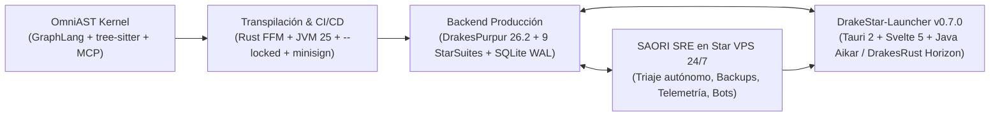

<!-- credits:start -->
> **What is DrakesCraft? / ¿Qué es DrakesCraft?**
> **EN:** DrakesCraft is a community Minecraft server (Chile) built around Slimefun. The **DrakesCraft Labs** organization keeps the open-source side: ports of Slimefun and its addons to current Minecraft/Paper (26.2, Java 25), a custom server fork (DrakesPurpur), the DrakeStar launcher and the tooling that tests all of it daily on the live server. Each addon is its own repository, built from its original author's code and published under that author's license.
> **ES:** DrakesCraft es un servidor de Minecraft comunitario (Chile) centrado en Slimefun. **DrakesCraft Labs** es la parte de código abierto: ports de Slimefun y sus addons a Minecraft/Paper actual (26.2, Java 25), un fork propio del servidor (DrakesPurpur), el launcher DrakeStar y las herramientas que lo prueban a diario en el servidor real. Cada addon es un repositorio propio, construido sobre el código de su autor original y publicado bajo la licencia de ese autor.
>
> **Credits / Créditos.** Creator and maintainer of the DrakesCraft system and ports: [JackStar6677-1](https://github.com/JackStar6677-1). Every repository credits its original authors with links at the top of its README and in `docs/UPSTREAM_ATTRIBUTION.md`; the full index is in [CREDITS.md](https://github.com/SlimefunNewHorizons/.github/blob/main/CREDITS.md). Highlights: Slimefun by [TheBusyBiscuit](https://github.com/TheBusyBiscuit) and the [Slimefun community](https://github.com/Slimefun); the Multiverse* addons by [Chagui68](https://github.com/Chagui68); launcher contributions by [DrgX89 (Nix)](https://github.com/DrgX89). Independent community project, not affiliated with or endorsed by the original authors or the official Slimefun team. Corrections: open an issue or mention [@JackStar6677-1](https://github.com/JackStar6677-1).
<!-- credits:end -->

# Slimefun: New Horizons · DrakesCraft Labs

> **«Un servidor de Minecraft comunitario construido alrededor de Slimefun: Purpur 26.2 con Java 25 y un puente Rust experimental, 9 StarSuites, más de 100 addons de Slimefun y un launcher de código abierto. Los resultados medidos y los límites conocidos están documentados en cada repositorio.»**

[🌐 Website](https://web.drakescraft.cl) ·
[🚀 DrakeStar Launcher v0.7.0](https://github.com/SlimefunNewHorizons/DrakeStar-Launcher/releases/latest) ·
[⚡ DrakesPurpur Engine](https://github.com/SlimefunNewHorizons/DrakesPurpur) ·
[🌌 StarSuites](https://github.com/SlimefunNewHorizons/Drakes-Suites) ·
[🧬 OmniAST](https://github.com/JackStar6677-1/omniast) ·
[⚖️ Rights & Attribution](https://github.com/SlimefunNewHorizons/.github/blob/main/RIGHTS_AND_ATTRIBUTION.md) ·
[💬 Discord](https://discord.gg/rv3vtXZTk7)

---

## ⚖️ Estado y licencias

- Muchos repositorios son **ports de addons de Slimefun de terceros**. Algunos quedaron sin terminar por sus autores originales y son **experimentales**: que estén publicados aquí no significa que estén completos, sean seguros ni tengan soporte.
- Cada repositorio indica sus autores originales y su licencia (ver su README y `docs/UPSTREAM_ATTRIBUTION.md`). Cuando un upstream no declara licencia (por ejemplo Automation y WorldwideChat) no distribuimos builds: el repositorio es privado o sus workflows de publicación están desactivados.
- El puente Rust FFM de DrakesPurpur es **experimental**; nuestras mediciones aún no muestran una mejora de extremo a extremo (ver los [resultados](https://github.com/SlimefunNewHorizons/DrakesPurpur/blob/feat/slimefun-native-engine/docs/hybrid/RESULTADOS.md)).
- Autores originales: si falta algo o hay un error, abre un issue o avísanos en [Discord](https://discord.gg/rv3vtXZTk7) y lo corregimos.

<!-- pillars:start -->
## 🏛️ Los 4 Pilares Principales

| Pilar | Rol | Línea activa | Repositorio |
| :--- | :--- | :--- | :--- |
| **DrakesPurpur** | Motor propio Purpur 26.2 + Java 25 (puente Rust FFM experimental y `DrakesEntityGuard`) | `26.2` / `feat/slimefun-native-engine` | [SlimefunNewHorizons/DrakesPurpur](https://github.com/SlimefunNewHorizons/DrakesPurpur) |
| **Drakes-Suites** | 9 StarSuites modulares que consolidan 180+ micro-plugins y 94 addons de Slimefun sobre SQLite WAL | `26.x` (producción) | [SlimefunNewHorizons/Drakes-Suites](https://github.com/SlimefunNewHorizons/Drakes-Suites) |
| **Slimefun6** | Continuación mantenida de Slimefun para Minecraft `1.21 → 26.2` con 110+ addons en producción | `main` (`26.2`) | [SlimefunNewHorizons/Slimefun6](https://github.com/SlimefunNewHorizons/Slimefun6) |
| **DrakeStar-Launcher** | Launcher multiplataforma Tauri 2 + Rust + Svelte 5 (`1-Click Play`, minisign y Modo Monolito Local) | `main` (`v0.7.0`) | [SlimefunNewHorizons/DrakeStar-Launcher](https://github.com/SlimefunNewHorizons/DrakeStar-Launcher) |
<!-- pillars:end -->

## 🧭 Arquitectura Global del Ecosistema

---

## 🚀 Matriz de Descarga Directa — DrakeStar-Launcher (`v0.7.0`)

**1-Click Play** con **Modo Dual** (**Java Aikar G1GC** + **DrakesRust / Horizon 26.3**) y **Monolito Local** (*Slimefun en solitario / LAN* arrancando `DrakesPurpur 26.2` en ~22 s en `127.0.0.1` sin configuración manual). Todas las builds son compiladas con `--locked` y firmadas criptográficamente con **minisign**.

| Plataforma | Instaladores Oficiales | Firma & Actualizador | Enlace Directo |
| :--- | :--- | :--- | :--- |
| **Windows** (x64) | `.exe` (recomendado, sin admin) · `.msi` | Minisign + Auto-Update | [Descargar Windows (latest)](https://github.com/SlimefunNewHorizons/DrakeStar-Launcher/releases/latest) |
| **Linux** (x64) | `.AppImage` · `.deb` · `.rpm` | Minisign + Auto-Update | [Descargar Linux (latest)](https://github.com/SlimefunNewHorizons/DrakeStar-Launcher/releases/latest) |
| **macOS** (Apple Silicon / Intel) | `.dmg` · `.app` | Minisign · **sin probar en macOS aún** | [Descargar macOS (latest)](https://github.com/SlimefunNewHorizons/DrakeStar-Launcher/releases/latest) |

---

## 🌌 Índice Canónico de StarSuites (`Drakes-Suites` Monorepo)

Consolidación de **180+ micro-plugins y 94 addons históricos** en **9 suites modulares** respaldadas por **SQLite WAL**; el puente Rust FFM es experimental y aún no tiene una mejora de extremo a extremo demostrada:

| # | Suite | Dominio Consolidado | Estado |
| :-: | :--- | :--- | :--- |
| 1 | **`drakes-core`** | Núcleo común, puertas de modalidad (`CommandModalityGate`), puente FFM/SQLite WAL y API compartida | **Producción** |
| 2 | **`drakes-tech`** | Maquinaria industrial, automatización avanzada, redes de alto rendimiento y energía off-heap | **Producción** |
| 3 | **`drakes-magic`** | Addons arcanos, alquimia, cristales, hechizos y progresión mística | **Producción** |
| 4 | **`drakes-bio`** | Genética mendeliana (`genetic_chickens`, **`genetic_woolies`**), cultivos (`Cultivation`) y biología | **Producción** |
| 5 | **`drakes-combat`** | Jefes (`/bosses`), habilidades divinas, rangos de combate (`DrakesRankup`) y balance PvP/PvE | **Producción** |
| 6 | **`drakes-generators`** | Reactores, generadores solares/nucleares, turbinas y densidad energética | **Producción** |
| 7 | **`drakes-multiverse`** | Integración con `MultiverseNets`, `MultiverseGambling` y utilidades inter-mundo | **Producción** |
| 8 | **`drakes-utility`** | Herramientas QoL, `EnderCarryOn` blindado, mochilas, transporte y utilidades de inventario | **Producción** |
| 9 | **`drakes-server`** | Telemetría (`DrakesPerf`), moderación, economía dinámica y gobierno de TPS | **Producción** |

> **Ramas canónicas:** `26.x` es la línea en producción (Purpur 26.2 + Java 25, Dallas Temporada 2). `main` es la línea anterior (Paper 1.21.11 LTS, Temporada 1).

---

## 🟢 Slimefun 6 — nuestra continuación de Slimefun

El Slimefun original terminó su desarrollo en octubre (1.21 fue su última versión oficial, el repositorio se archiva y los forks son bienvenidos). **[Slimefun6](https://github.com/SlimefunNewHorizons/Slimefun6)** es nuestro core mantenido: una sola base de código para Minecraft **1.21 → 26.2**, en producción en la Temporada 2 junto a **110 addons de la comunidad** (lista con versiones en su README, tomada de `/sf versions`), aceleración Rust por la API FFM de Java y releases con checksums SHA-256. La historia de nuestro core anterior está en su rama `legacy/slimefun4-drake-1.21`.

---

## 📊 Clasificación de Repositorios (Zero-Assumptions)

- **🟢 Producción Activa:** `DrakeStar-Launcher` (`v0.7.0`), `Drakes-Suites` (9 StarSuites), `DrakesPurpur` (motor 26.2 Java 25 + Rust FFM), `Odysseia`, `Slimefun6`, `NetworksV6-drake` (Cloud-Link + rendimiento), `MultiverseNets` (59 bloques + guía SF), `MultiverseGambling`, `drakescraft-web`, `drakescraft-texture-pack` (`t2-v28.zip`), `ai-hub` / SAORI SRE en Star VPS.
- **🔵 Soporte & Núcleo Transversal:** `OmniAST` (GraphLang + `tree-sitter-omniast` + `mcp_server`), `star-server-backup` (Zero-Secrets diario), `drakes-hq`, `maven-repo`, `slimefun-porting-tools`.
- **🧪 Sandbox / Experimental:** `drakestar-fused` (bridge mod single-JVM Fabric/NeoForge/Forge v1.0.0-alpha.2), `Slimefun-Rust` / `Odysseia-Rust`, ramas `feat/slimefun-native-engine` (motor híbrido Rust permanente).
- **📦 Legado / Reemplazados (mantenidos sin archivar como referencia e historial):** `Slimefun4-Igdrassil`, `NetworksExpansion-Igdrassil`, `Bump-Igdrassil`, `SlimefunAdvancements-Igdrassil`, `JustEnoughGuide-Igdrassil`, `Igdrassil`, `Slimefun4-1.20.6-Port`, `Slimefun4-Drake`, `Rebar-Drake` — reemplazados por `Slimefun6`, `Drakes-Suites`, `DrakesPurpur` y `NetworksV6-drake`. Cada repo indica su reemplazo al inicio de su README.

---

## ⚙️ Directiva Operativa de Equipo (CI/CD Mandate)

1. **Cero compilaciones manuales para release:** Todo artefacto de producción se compila y firma exclusivamente mediante **GitHub Actions** (`--locked` en Rust, Maven/Gradle reproducible en Java 25 y firmas **minisign**).
2. **Despliegue seguro verificado:** Todo despliegue a Dallas pasa por verificación de SHA-256, respaldo rollback automático en Google Drive y reinicio seguro con anuncios automáticos en Discord (`#⛏️・anuncios-minecraft` y `#🚀・server-changelog`).
3. **Equipo Humano + SRE Autónoma:**
   - **JackStar (`JackStar6677-1`)** — Arquitectura Soberana & Dirección Técnica.
   - **Nix (`DrgX89`)** — Releases, CI/CD, Embalaje Multiplataforma & Linux.
   - **Chagui (`Chagui68`)** — `MultiverseNets`, `MultiverseGambling`, `DrakesPurpur` & Testing.
   - **SAORI (Star VPS 24/7)** — Triaje autónomo, monitoreo de logs, respaldos y self-healing.
